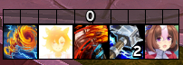

# WoW Icon Swapper

A small Windows app for replacing World of Warcraft Retail ability icons with your own images. Choose an image, find an ability, and install a correctly named **64×64 TGA** into your WoW folder.

## Features

- Find abilities by English name, spell ID, or Wowhead spell link.
- Choose between matching spells using their IDs and categories.
- Browse for an image or drag and drop it into the app.
- Preview the resized icon before installing.
- Fill the square with a center crop, or fit the entire image with transparent padding.
- Preserve transparency in an uncompressed 32-bit TGA.
- Resolve texture filenames, including numeric texture IDs.
- Remember your WoW installation folder.
- Back up existing custom icons before replacing them.

## Requirements

- Windows 10 or Windows 11
- .NET Framework 4.8
- World of Warcraft Retail
- Internet access for spell lookup

No Python, Node.js, or installer is required.

## Getting started

1. Extract the application ZIP into a folder of your choice.
2. Keep `icon-names.csv` in the same folder as `WoW-Icon-Swapper.exe`.
3. Double-click `WoW-Icon-Swapper.exe`.

## Usage

1. **Choose an image.** Supported formats: PNG, JPG, BMP, GIF, and TIFF.
2. **Choose the resize mode.** Use **Fill square** to crop around the center, or **Fit entire image** to add transparent padding.
3. **Find the ability.** Enter its English name, spell ID, or Wowhead spell link, then click **Find spell**. Select the correct result if multiple spells share the same name.
4. **Choose your WoW folder.** Select either `World of Warcraft` or its `_retail_` subfolder.
5. **Fully close WoW**, then click **Install custom icon**.
6. **Launch WoW again** to load the new icon. `/reload` alone will not load newly added textures.

Example spell inputs:

| Ability | Spell ID | Wowhead link |
| --- | --- | --- |
| Ascendance — Enhancement Shaman | `114051` | [Ascendance](https://www.wowhead.com/spell=114051) |
| Crash Lightning | `187874` | [Crash Lightning](https://www.wowhead.com/spell=187874) |


<p align="center">
  <br>
  <em>Original 400×400 image</em>
</p>

<p align="center">
  <br>
  <em>Resized to 64×64</em>
</p>

<p align="center">
  <br>
  <em>Final swapped-out result in-game</em>
</p>


### Install location

The app creates the icon directory if needed and installs the file here:

```text
World of Warcraft/
└── _retail_/
    └── Interface/
        ├── Icons/
        │   └── <texture-name>.tga
        └── IconSwapperBackups/
            └── <texture-name>-<timestamp>-<suffix>.tga
```

Backups are created when an existing TGA is replaced. Other icon replacements remain in place. A texture replacement affects every UI element that uses that texture.

## Restoring an icon

1. Fully close WoW.
2. To restore the game's original texture, delete the corresponding TGA from `_retail_/Interface/Icons`.
3. To restore a previous custom icon, copy its backup from `IconSwapperBackups` into `Icons` and rename it to the original texture filename, removing the timestamp and suffix.
4. Launch WoW again.

## Lookup and privacy

Spell names and IDs are sent to Wowhead for lookup. Your images and local installation paths are not uploaded.

When Wowhead returns a numeric texture ID, the app resolves it using the bundled `icon-names.csv`. If that ID is missing, it downloads the current public interface list from [wowdev/wow-listfile](https://github.com/wowdev/wow-listfile).

The downloaded mapping and remembered WoW folder are stored locally:

```text
%LOCALAPPDATA%/WoWIconSwapper/
├── interface.csv       # Downloaded mapping, when needed
└── wow-folder.txt      # Remembered WoW installation folder
```

If the texture filename cannot be resolved, the app shows an error and does not install a file.

## Building from source

Run the included build script in **Windows PowerShell** from the repository root:

```powershell
.\source\build.ps1
```

The script uses the .NET Framework C# compiler installed with Windows and writes `WoW-Icon-Swapper.exe` to the repository root. Keep `icon-names.csv` beside the executable when running or distributing it.

### Repository layout

```text
.
├── README.md
├── icon-names.csv
├── WoW-Icon-Swapper.exe
└── source/
    ├── IconSwapper.cs
    └── build.ps1
```

## Troubleshooting

| Problem | What to check |
| --- | --- |
| The icon has not changed | Fully exit and relaunch WoW. Confirm the file is in `_retail_/Interface/Icons`. |
| Multiple spells have the same name | Select the correct spell ID and category, or search using the exact ID. |
| Spell lookup fails | Check your internet connection and try the spell ID. Metadata endpoints may change and require an app update. |
| The texture filename cannot be resolved | Keep `icon-names.csv` beside the executable and allow access to GitHub for missing numeric IDs. |
| Windows denies access to the WoW folder | Close the app, use **Run as administrator**, and retry the installation. |
| The image is cropped | Choose **Fit entire image** to preserve the full image with transparent padding. |

## Verification

The app was checked for:

- Exact RGBA pixel preservation for both supplied 64×64 test images.
- Resizing, center cropping, transparent padding, and partial transparency.
- TGA dimensions, file size, and uncompressed 32-bit encoding.
- Installation paths, invalid folder rejection, and exact backups of replaced files.
- Live Ascendance and Crash Lightning lookups, including numeric texture resolution.
- Live ability name search.

File installation was tested in an isolated mock WoW folder. The two manually prepared icon replacements that preceded the app were confirmed working in game.

## Data sources

- [Wowhead](https://www.wowhead.com/) — spell metadata and search.
- [wowdev/wow-listfile](https://github.com/wowdev/wow-listfile) — public texture filename mappings. The bundled icon mapping was filtered from `parts/interface.csv` on October 26, 2026.
- [Clean Icons — Mechagnome Edition](https://www.wowinterface.com/downloads/info25064-CleanIcons-MechagnomeEdition) — texture replacement installation and restart reference.
